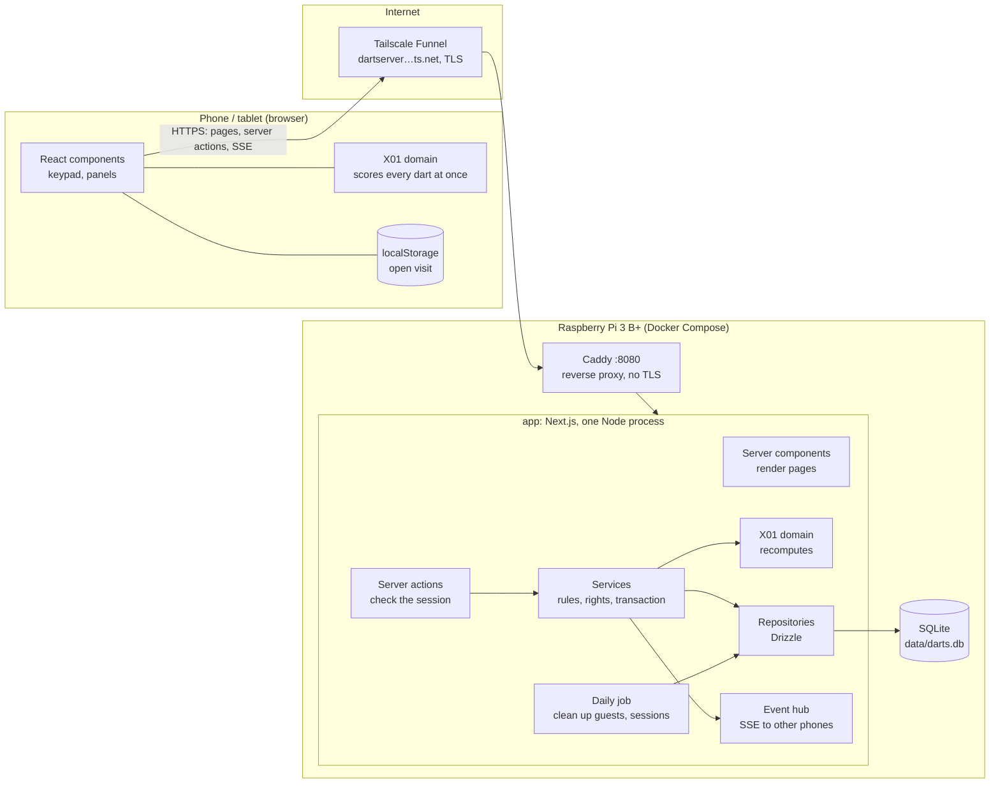
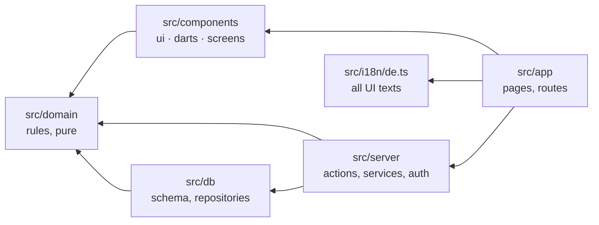
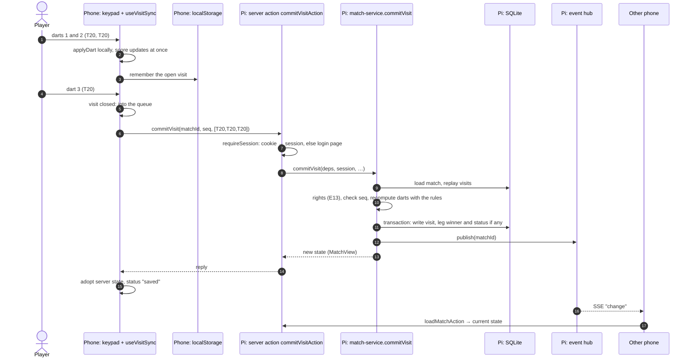
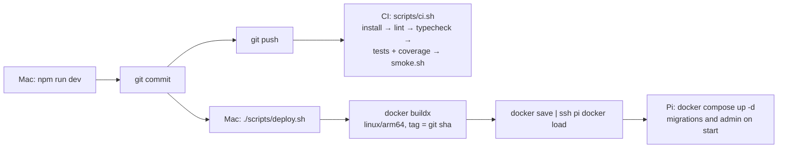

# Darts Scorer Web

Web port of the iOS app "Dart" (Swift source in `Legacy/`) as a Next.js app with SQLite, running on a Raspberry Pi behind Tailscale Funnel. Players count darts on their phones; the Pi stores every visit and serves the app at **https://dartserver.swallow-pythagorean.ts.net**.

Plans and decisions live in `docs/` (German):

- `docs/architecture.md`: stack, network, data model, code conventions, decisions E1–E15
- `docs/project.md`: milestones with checklists and definitions of done
- `docs/m*-plan.md`: step-by-step plan per milestone; finished plans are in `docs/archive/`
- `docs/legacy-analysis.md`: rules and screens of the Swift app
- `docs/theme.md`: colours, dark mode, layout rules
- `docs/prompt.md`: current state and how to continue (start here after a break)

## Requirements

- Node 22 (LTS) and npm
- For deploying: Docker Desktop (buildx), SSH access to the Pi as `ssh pi`

## Getting started

```bash
npm install
cp .env.example .env      # then set ADMIN_PASSWORD_HASH, see Configuration
npm run dev               # http://localhost:3000, log in as ADMIN_USER
```

The SQLite file is created at `./data/darts.db` on first start. Development-only pages: `/dev/theme` (scoring layout with all tokens) and `/dev/tokens` (colour table).

### Configuration

| Variable | Local `.env` | Pi `~/darts/.env` | Meaning |
|---|---|---|---|
| `ADMIN_USER` | `admin` | `darts` | Name of the first admin |
| `ADMIN_PASSWORD_HASH` | first line of the script | second line of the script | bcrypt hash of the admin password |
| `APP_URL` | `http://localhost:3000` | `https://dartserver.swallow-pythagorean.ts.net` | Address used in invite links and QR codes |
| `COOKIE_SECURE` | `false` (plain http) | not set (`true`) | Secure flag of the session cookie |
| `DATABASE_PATH` | `./data/darts.db` | set by `docker-compose.yml` | SQLite file |
| `IMAGE_TAG` | – | set by `deploy.sh` | Image version that runs |

The admin user and hash only take effect on start-up as long as the database has no admin yet; after that the database is the source of truth (`docs/architecture.md` §10).

Create the hash with:

```bash
node scripts/hash-password.mjs 'your-password'
```

It prints the same hash three times, because each consumer reads `$` differently. A bcrypt hash looks like `$2b$12$…`. Both Next (reading the local `.env`) and Docker Compose (reading `~/darts/.env` on the Pi) treat `$name` as a variable and silently replace that part with nothing. The script therefore escapes it: `\$` for the local `.env`, `$$` for the Pi. The third line is the raw hash for use outside these files. A wrongly escaped hash stops the app at start with "bcrypt hash expected".

## Using the app

### Accounts, invitations, password reset

There is no sign-up. The admin invites every player (`docs/architecture.md` E10):

- **Invite:** Konto → "Einladungslink erzeugen" shows a QR code. The new player scans it and chooses a name and a password (at least 8 characters). A name that is already taken is refused. The code works once and for 24 hours.
- **Login for an existing player without login** (promoted guest, deleted login): Konto → Spieler → "Login erzeugen". It is also a QR code; the player only sets a password.
- **Forgotten password:** the admin uses Konto → Spieler → "Passwort zurücksetzen". All sessions of that player end.
- **Delete login** keeps the player and their history; **delete player** only works for players without matches. Neither works on admins.
- Players rename themselves and guests; the admin renames everyone.
- A login lasts one year. After 10 failed attempts within 15 minutes from one IP, logins pause.

**Forgotten admin password:** create a hash with the script, then on the Pi set the third line (the plain hash) directly:

```bash
cd ~/darts
docker compose exec -T app node -e 'new (require("better-sqlite3"))("/data/darts.db").prepare("update player set password_hash = ? where is_admin = 1").run(process.argv[1])' 'PASTE_THE_PLAIN_HASH'
```

### Several devices

When starting a game you choose **"Eingabe: ein Handy"** (default: the phone that started counts everyone) or **"jeder selbst"** (every player with a login enters their own darts on their own phone; guests are entered on the starting phone). Other phones find the game on the start page under "Laufende Spiele".

All phones show the same score without reloading. This uses **Server-Sent Events** (SSE): each phone keeps one plain HTTP response open to `/api/match/<id>/events`, and the Pi writes a short "change" line into it whenever a visit is saved or the game is cancelled. The phone then fetches the current state. SSE only works from server to browser, which is enough here, because input already goes the other way through server actions. The browser reconnects by itself after a drop. Details: E13 in `docs/architecture.md`.

The host or an admin can cancel a game. A running game older than 24 hours counts as finished.

### Guests

Anyone can add a guest in the game setup ("Gast hinzufügen"). Guests stay in the lists for 24 hours and can then play in further rounds and other modes. Games with guests never count for rankings. Once the last guest has expired, the app deletes those games, but first adds the field hits of the regular players to `player_field_hits`. This cleanup runs on start and once a day. Details: E12.

## Testing

```bash
npm test                  # all unit and UI tests (domain in Node, UI in jsdom)
npm run test:coverage     # tests plus coverage thresholds per layer (vitest.config.mts)
npm run test:watch        # watch mode
npx vitest run src/domain/x01   # one folder or file
npm run lint              # ESLint incl. the layering rule
npm run typecheck         # TypeScript without build
./scripts/smoke.sh        # browser run against the production build (see below)
./scripts/ci.sh           # everything the CI runs; needs `npx playwright install chromium` once
```

**Browser run** (`scripts/smoke.sh`): builds for production, starts the standalone server on port 3100 with a test admin (`admin` / `admin-secret`) and a fresh database in `/tmp/sa`, then drives Chromium through `scripts/smoke-match.mjs`. Several browser contexts play the main flows. They log in and check the redirect without a session, redeem invites, test rename rights, and play a 301 leg with 180, bust, undo, reload, checkout and restart. They add, rename and remove guests, cancel a game, and play on two devices with live updates. Finally they reset a password, delete a login, log out and hit the rate limit. The run also checks security headers and fails on any Content-Security-Policy violation. Each `• ok:` line is a check and `✗` a failure. Screenshots go to `docs/screenshots/` and are committed, so the current look can be seen without building.

**Layout check** of the scoring screen in five viewports, light and dark: `npx next dev --port 3100 &` then `node scripts/screenshots.mjs ./screenshots`. It reports whether a page scrolls (it must not).

**CI:** `.github/workflows/ci.yml` only calls `scripts/ci.sh`. The pipeline fails below the coverage thresholds, and the screenshots are attached as an artifact.

## Deploying to the Pi

### How the Pi is reachable: Tailscale and Caddy

```
phone ──HTTPS──▶ Tailscale Funnel ──▶ Pi: tailscaled ──▶ Caddy 127.0.0.1:8080 ──▶ app:3000 (Docker network)
```

- **Tailscale Funnel** gives the Pi a public HTTPS address without opening a port in the home router. The connection is DS-Lite, so there is no public IPv4 anyway. The Pi connects out to Tailscale. `tailscaled` on the Pi holds the Let's Encrypt certificate, ends TLS and forwards plain HTTP to port 8080 on localhost.
- **Caddy** is a small reverse proxy container. It is the only container with a port on the host (`127.0.0.1:8080`) and forwards into the Compose network to the app. It compresses responses, tells the app the original request was HTTPS, and passes SSE through unbuffered. The app container itself publishes no port.

Background, privacy notes and why there is no Basic Auth any more: `docs/architecture.md` §2, §4 and §10.

### One-time setup

On the Mac: `ssh pi` as an alias in `~/.ssh/config` with the key in the ssh agent (`ssh-add --apple-use-keychain ~/.ssh/id_ed25519`; test with `ssh -o BatchMode=yes pi hostname`), and Docker Desktop running.

On the Pi: Docker with the Compose plugin, Tailscale with `tailscale funnel --bg 8080`, then `mkdir -p ~/darts/data` and create `~/darts/.env` from `deploy/env.example` (values: see Configuration).

The Pi never builds and holds no repository, only `~/darts/` with `.env`, `docker-compose.yml`, `Caddyfile` and `data/`. A Next.js build does not fit into the Pi 3 B+ (1 GB RAM).

### Releasing a new version

Only when asked to, after a green pipeline:

```bash
git status                # commit first, otherwise the image is tagged <sha>-dirty
./scripts/deploy.sh
```

The script builds `darts-app:<git-sha>` for `linux/arm64` on the Mac and streams it to the Pi (`docker save | ssh pi docker load`). It copies `docker-compose.yml` and `Caddyfile`, sets `IMAGE_TAG`, and runs `docker compose up -d`. Finally it checks health: the app answers `{"ok":true}`, and Caddy answers `307` (redirect to `/login`). Database migrations and the admin bootstrap run when the app starts.

There is deliberately no backup (E14). If `data/darts.db` is lost, the next start creates it again with the admin from `.env`, and players are invited again. To start over on purpose: `docker compose stop app && rm -f data/darts.db*` then `docker compose up -d`.

### Rollback

Older images stay on the Pi with their tag:

```bash
ssh pi 'docker images darts-app'
ssh pi 'cd darts && sed -i "s/^IMAGE_TAG=.*/IMAGE_TAG=<old-sha>/" .env && docker compose up -d'
```

Run `ssh pi docker image prune -a` now and then when space runs low.

### After a reboot of the Pi

Normally nothing is needed. Docker is enabled as a service, both containers have `restart: unless-stopped`, and `tailscaled` with the funnel setting persists. After one or two minutes, check:

```bash
systemctl is-active docker tailscaled    # both: active
cd ~/darts && docker compose ps          # app (healthy) and caddy: Up
tailscale funnel status                  # https://dartserver.… → http://127.0.0.1:8080
```

If something is missing, run `sudo systemctl enable --now docker tailscaled`, `docker compose up -d` and `tailscale funnel --bg 8080`. After `docker compose down` the containers do not come back on boot by themselves; after `stop` or a reboot they do.

### Looking around on the Pi

```bash
cd ~/darts
docker compose logs -f app         # one JSON line per event (login, invite, cleanup, errors)
docker compose logs app --no-log-prefix | grep '^{' | jq -c 'select(.level != "info")'   # warnings and errors only
docker compose restart app
tailscale funnel status
```

To try the image locally without the Pi, build `darts-app:local` and run `IMAGE_TAG=local docker compose up`. The app is then at http://localhost:8080, using the Compose-style `.env`.

## Architecture at a glance

One page to get back into the project. Reasons and details are in `docs/architecture.md`.

### What runs where



- **On the phone** React renders panels, keypad and hint line. Every dart is scored locally at once, using the same domain code the server uses (`src/domain`, plain TypeScript). The visit in progress lives only in this phone's localStorage (E11).
- **On the Pi** one Node process renders pages and accepts server actions. It checks session and rights, recomputes every visit with the domain and writes it to SQLite. It also runs the event hub for live updates and the daily cleanup. Login rate limit and event hub live in the memory of this one process, a deliberate limit (`docs/architecture.md` §5).
- **Over the network** go only page requests, finished visits (`commitVisit`), undo (`undoVisit`) and the SSE stream, never single darts.

### Layers in the code



Arrows are the allowed imports; ESLint rejects all others. Components get data and actions only as props from the pages. Services get everything through `Deps`: the repositories `players`, `matches`, `auth` and `tournaments`, plus clock, ids, randomness, event hub and transaction. That is why they run in tests against in-memory repositories (`src/server/testing.ts`). Only visits are stored; remaining score, winner and statistics are always computed from them (`docs/architecture.md` §6).

### Adding a language

The app is German only for now; every visible text lives in `src/i18n/de.ts`.

1. Create `src/i18n/en.ts` with `export const en: Texts = { … }` (`Texts` from `./de`) and translate every text. Keep placeholders such as `{n}` and `{name}`; the components fill them in.
2. Run `npm run typecheck`. `Texts` has the keys of `de` with plain strings as values, so a missing or misspelled key fails the check.

There is no language selection yet. Pages and server actions import `de` directly, and `src/app/layout.tsx` sets `lang="de"`. Choosing by the browser's (that is, the system's) language would mean:

- A helper in `src/i18n` picks the texts from the `Accept-Language` header and falls back to `de`.
- Pages call that helper (they already read the request via `connection()`) instead of importing `de`, and pass the texts on as props. Components need no change.
- The layout sets `lang` to the chosen language.
- The smoke test drives the app by its German labels, so it then needs `locale: "de-DE"` in its Playwright contexts.

The component tests take every label from `de`, so they stay as they are. To run one against another language too, wrap it in `describe.each([de, en])`.

### Entering a visit



If the network drops, `useVisitSync` retries with backoff and shows "nicht gespeichert". If the server says no for a domain reason, the phone adopts the server state. That happens when another phone was faster or the game was cancelled.

### Build, check, ship



| What | Where | How |
|---|---|---|
| Develop | Mac | `npm run dev` with `.env` (Configuration) |
| Unit and UI tests | Mac and CI | `npm test`, `npm run test:coverage` |
| Browser run | Mac and CI | `./scripts/smoke.sh` |
| CI | GitHub Actions | the pipeline file only calls `scripts/ci.sh` (E15) |
| Build the image | Mac, never on the Pi | `Dockerfile`: dependencies → build → slim runtime image |
| Ship | Mac → Pi over SSH | `./scripts/deploy.sh`, only when asked; rollback via `IMAGE_TAG` |
| Database schema | generated on the Mac, applied on the Pi | edit `src/db/schema.ts`, `npm run db:generate`; the migration runs on the next start |

### Getting back in, in five steps

1. Read `docs/prompt.md` (state, next milestone, way of working) and `git log --oneline -20`.
2. `npm install`, create `.env` (Configuration), `npm run dev`, log in as admin.
3. Run `./scripts/ci.sh` once; green means the setup is fine.
4. Read the plan of the next milestone in `docs/` and answer the open questions at its end.
5. Before a deploy: green pipeline, `./scripts/deploy.sh`, then `ssh pi 'cd darts && docker compose logs --tail 20 app'`.
